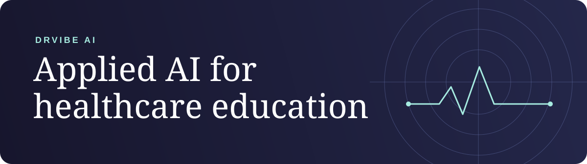

# DrVibe AI

DrVibe builds practical AI education and open-source tools for healthcare professionals. This GitHub organization also houses the engineering behind **Perceptors**, the healthcare learning platform developed by GCLS AI Lab.

[Explore Perceptors](https://www.perceptors.ai/) · [See a live academy](https://gcls.academy/) · [Learn with DrVibe](https://drvibe.ai/) · [Browse agent tools](https://github.com/DrVibeAI/agent-tools)

## Perceptors

Perceptors helps academic medical centers, medical societies, and health systems turn faculty expertise into reviewed courses and branded academies.

- **Course production.** Specialist agents map claims to sources and draft lessons, assessments, and localized editions. Named reviewers approve the evidence and content before release.
- **Learner experience.** Academies bring courses, assessments, and progress together with a Guide that answers from approved material and cites its sources.
- **Review and credentials.** Reviewers can inspect a course and its supporting evidence before approving it. Academies can issue credentials under their program's rules.

Perceptors is live in the UAE with built-in GCLS healthcare courses. Explore the [platform](https://www.perceptors.ai/technology), [customer stories](https://www.perceptors.ai/customers), and [research behind the approach](https://www.perceptors.ai/evidence).

## Learn with DrVibe

DrVibe.ai teaches healthcare professionals to build AI agents, clinical workflow tools, and healthtech apps. Start with the [course catalog](https://drvibe.ai/courses) or browse [DrVibe Skills](https://drvibe.ai/skills/).

## Build with DrVibe

[**DrVibeAI/agent-tools**](https://github.com/DrVibeAI/agent-tools) is our Apache-2.0 repository for clinical AI tooling.

| Project | What you can do with it |
| --- | --- |
| [Clinical APIs MCP](https://github.com/DrVibeAI/agent-tools/tree/main/packages/clinical-apis-mcp) | Connect an agent to public biomedical sources including PubMed, ClinicalTrials.gov, Europe PMC, and openFDA. |
| [PHI Guard](https://github.com/DrVibeAI/agent-tools/tree/main/packages/phi-guard) | Add a BAA-aware gate and local redaction and rehydration to workflows that need to minimize exposure of protected health information. |
| [Public skills and plugins](https://github.com/DrVibeAI/agent-tools#public-skills) | Audit a practice's public website with the [Physician Website Privacy Audit](https://github.com/DrVibeAI/agent-tools/blob/main/skills/physician-website-privacy-audit/SKILL.md), or explore the [AI Physician and AI Resident plugins](https://github.com/DrVibeAI/agent-tools#plugins-claude-code-marketplace). |

Use public, non-PHI data with the public tools. They are for education and workflow support. See the [usage disclaimer](https://github.com/DrVibeAI/agent-tools/blob/main/DISCLAIMER.md) and [security policy](https://github.com/DrVibeAI/agent-tools/blob/main/SECURITY.md).

[DrVibe on LinkedIn](https://www.linkedin.com/company/drvibe-ai)
