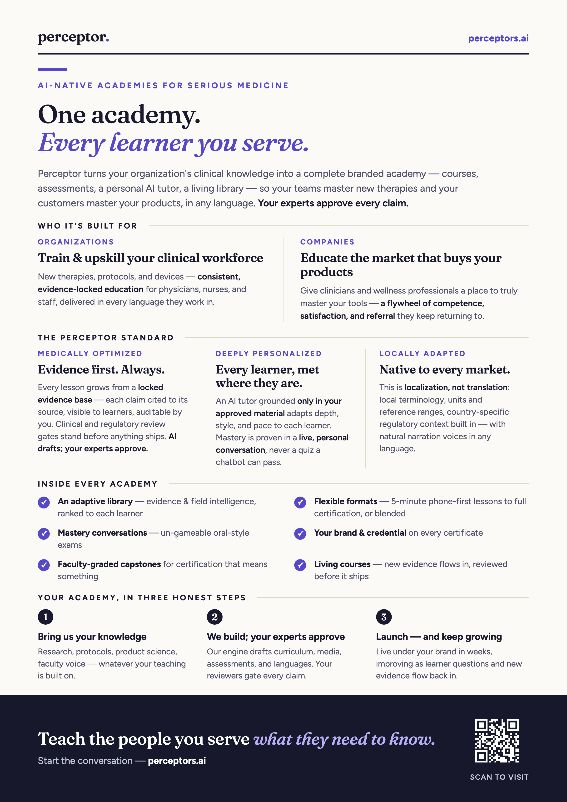

# DrVibe AI

**Perceptor** ([perceptors.ai](https://perceptors.ai)) — AI-native academies for serious medicine. One academy, every learner you serve.

- **Organizations** training and upskilling their clinical workforce — physicians, nurses, staff — on new therapies, protocols, and devices, with evidence-locked consistency and in every language they work in.
- **Companies** educating the market that buys their products — clinicians, wellness centers, practitioners — building a flywheel of competence, satisfaction, and referral around your tools.

Every academy ships under your brand: courses, assessments, a personal AI tutor grounded only in your approved material, and a living library. **AI drafts; your experts approve** — every claim cited, every market localized natively, not translated.

  

  <a href="https://perceptors.ai"><strong>perceptors.ai</strong></a>
  ·
  <a href="perceptor-handout.pdf">Download the one-pager (PDF)</a>
  ·
  <a href="perceptor-handout.png">Share the PNG</a>

DrVibe ([drvibe.ai](https://drvibe.ai)) is the company behind Perceptor: physician-built AI education, the course factory that produces academies, and the agent tooling we publish for the broader healthcare community.

## What we build

| Area | What it means |
| --- | --- |
| **Perceptor academies** | Branded, medical-grade education for orgs upskilling clinical teams and companies teaching the clinicians who use their products — in any language, with experts gating every claim. |
| **Course factory** | A production pipeline that turns a locked evidence corpus into structured lessons, assessments, tutor grounding, localization, and review-ready packages. AI drafts; humans approve. |
| **Agentic LMS** | Healthcare-focused learning with tutor, assessment, resource, progress, peer, and regulatory-support agents — an AI-native layer for clinical education and credentialing, not a generic LMS. |
| **Clinical agent tooling** | Open-source infrastructure that lets agents retrieve public biomedical data and reduce PHI exposure before using non-BAA models. |

## Who it is for

- Healthcare organizations training staff on new therapies, protocols, and devices — consistently, in every language they work in.
- Medtech, pharma, and wellness companies teaching physicians, nurses, and wellness professionals to use their products with confidence — a flywheel of competence, satisfaction, and referral.
- Healthcare educators and societies building AI-native courses, certifications, and capstone programs.
- Developers building compliant, healthcare-aware AI tools with public clinical data sources.

## Open-source tools

### [agent-tools](https://github.com/DrVibeAI/agent-tools)

Open-source clinical AI agent tooling from DrVibe.ai.

- **`@drvibeai/clinical-apis-mcp`** — an MCP server exposing free public clinical and biomedical APIs as agent tools, including ClinicalTrials.gov v2, PubMed, Europe PMC, openFDA, RxNorm, ICD-10-CM, MedlinePlus, and the NPI Registry.
- **`@drvibeai/phi-guard`** — PHI-minimization support for agent workflows, including a BAA compliance gate and local redact/rehydrate pattern so patient identifiers do not have to be sent to a non-BAA model.
- **Claude Code marketplace plugins** — installable healthcare agent packs such as `the-ai-physician` and `the-ai-resident`, built on the clinical MCP layer.

## Safety boundary

DrVibe open-source tools are educational and workflow infrastructure. They are **not** medical advice, **not** a medical device, and come with **no warranty**. Public tools should be used with public, non-PHI data unless your organization has the required agreements, privacy controls, review gates, and governance.

## Start here

- Visit [perceptors.ai](https://perceptors.ai) — academies for organizations and companies
- Visit [DrVibe.ai](https://drvibe.ai)
- Explore [DrVibeAI/agent-tools](https://github.com/DrVibeAI/agent-tools)
- Follow [DrVibe AI on LinkedIn](https://www.linkedin.com/company/drvibe-ai)
